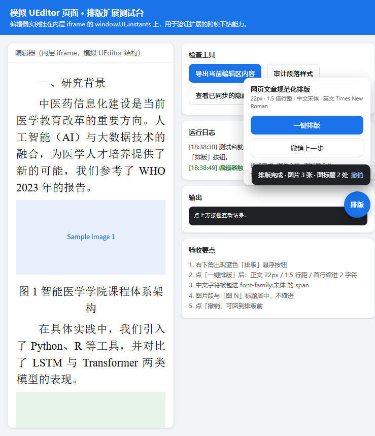

# 网页文章规范化排版 · Edge 扩展

一个轻量的 Microsoft Edge（Chromium MV3）扩展：在网页富文本编辑器（UEditor 等）里一键把文章正文排版规范化。

**排版规则**：排版前**先清除全部格式**（Word/网页粘贴残留的旧字体、颜色、加粗、class 等一律清掉，仅保留文字、段落、图片、超链接），然后统一套用：正文 22px｜行距 1.5 倍｜中文用宋体｜英文与罗马数字用 Times New Roman｜图片与图标题居中｜正文首行缩进 2 字符。

---

## 效果预览



左侧是排版后的正文（宋体、首行缩进、两端对齐），图片与图标题居中；右下角是悬浮按钮、操作面板和结果提示。

---

## 一、安装（同事照做即可）

1. 在本仓库页点右上角 **Code → Download ZIP**，解压到任意固定位置，**不要删**（扩展运行时会一直读这个文件夹）。
2. 打开 Edge，地址栏输入 `edge://extensions/` 回车。
3. 打开左下角 **开发人员模式** 开关。
4. 点 **加载解压缩的扩展**，选择**含 `manifest.json` 的那一层文件夹**（即解压出来的一级目录）。
5. 完成后工具栏会出现蓝色「排」图标。若没显示，点工具栏的拼图图标把它固定出来。

> 更新版本时：替换文件夹内容后，回到 `edge://extensions/` 点该扩展的「重新加载」。

---

## 二、使用

打开你的文章编辑页（确保编辑器已加载出内容），然后**二选一**触发：

- **悬浮按钮**：页面右下角会出现蓝色圆形「排版」按钮 → 点它展开面板 → 点「一键排版」。
- **工具栏图标**：直接点工具栏上的「排」图标。

排版完成后右下角弹出结果提示（图片数、图标题数），并带一个 **撤销** 链接；面板里也有「撤销上一步」。

> 排版不会自动运行，必须手动点。**注意：排版会先清除文章原有全部格式**（加粗、颜色、旧字体等），只保留文字、图片和链接；如个别地方需要强调样式，排版后手动补。排版后**记得回到编辑器的保存/提交按钮**把内容存下来。

---

## 三、目录结构

```
edge-typesetting/
├── manifest.json              # MV3 清单
├── src/
│   ├── engine.js              # MAIN world：排版引擎（可访问 window.UE）
│   ├── bridge.js              # ISOLATED world：悬浮按钮 + 事件桥 + 撤销
│   └── background.js          # service worker：工具栏图标触发
├── assets/                    # 图标 16/32/48/128
├── test/
│   ├── ueditor-mock.html      # 模拟 UEditor 测试台
│   └── editor-frame.html      # 内层 iframe（模拟 UEditor 结构）
├── DESIGN.md                  # 设计与技术方案
└── README.md
```

---

## 四、技术要点（想改代码的看这里）

**为什么引擎必须跑在主世界？**
UEditor 的实例挂在页面的 `window.UE.instants` 上，而 MV3 的 content script 默认运行在隔离世界，**拿不到**它。所以 `engine.js` 以 `"world": "MAIN"` 注入。代价是主世界里没有 `chrome.*` API，于是 UI 全部放到隔离世界的 `bridge.js`，两边用 `document` 上的 `CustomEvent` 通信（`detail` 统一传 JSON 字符串）。

**通信协议**

| 事件 | 方向 | 说明 |
|---|---|---|
| `tws:probe` / `tws:probe-result` | 隔离 ↔ 主 | 探测页面是否存在编辑器 |
| `tws:format` / `tws:format-result` | 隔离 ↔ 主 | 执行排版并回报校验结果 |
| `tws:undo` / `tws:undo-result` | 隔离 ↔ 主 | 回滚到排版前 |

**回写同步**：`setContent()` 之后会补调 `ed.sync()` 与 `ed.fireEvent('contentchange')`，保证后台表单能读到改动。

**中英混排**：按字符把文本节点拆成多个 `<span>`（中文一段、英文/数字一段），这样编辑器左边的字体下拉框选中中文时能正确显示「宋体」。

---

## 五、开发与测试

**手动测试**

```powershell
cd edge-typesetting\test
python -m http.server 8899 --bind 127.0.0.1
```

浏览器打开 `http://127.0.0.1:8899/ueditor-mock.html`，扩展加载后右下角会出现「排版」按钮。测试台右侧有「导出当前编辑区内容」「审计段落样式」「查看已同步的隐藏域」三个检查工具。

**自动化测试**（改完引擎后建议跑一遍）

- 引擎逻辑回归：用 jsdom 直接加载 `src/engine.js`，校验段落样式、中英拆 span、事件往返、撤销还原。
- 真实浏览器 E2E：以 `--load-extension` 启动 Edge，通过 CDP 驱动悬浮按钮，校验双世界通信与最终 computed 样式。

---

## 六、已知限制与注意事项

| 项 | 说明 |
|---|---|
| 权限范围 | 开发期 `matches` 为 `<all_urls>`（通配符，便于调试）。**正式分发/上架前必须收窄到真实 CMS 域名**。 |
| 编辑器类型 | 目前按 UEditor（`window.UE.instants`）定位；其他编辑器需扩展 `engine.js` 的定位逻辑。 |
| 字体依赖 | 宋体是 Windows 默认字库，一般无缺字风险；非 Windows 系统可能回退。 |
| 内容体积 | 拆 `<span>` 会让 HTML 变大（换来字体面板显示正确）。如需精简可改为纯 CSS 字体栈方案。 |
| 企业策略 | 若公司策略禁止侧载扩展，需要走 Edge 加载项商店分发。 |
| 撤销范围 | 撤销备份保存在内存中，**刷新页面后失效**。 |
